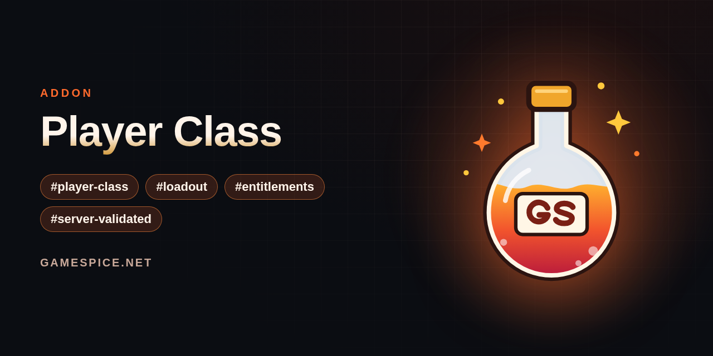

[](https://moddingcommunity.com/a/249-dot-player-class)

Player classes (health, speed, loadout, abilities) as a small document a dedicated server can check without loading any content.

A class change is recorded and applied on the next spawn, so nobody changes health or weapons mid-fight. A dead player gets the change immediately.

## Install

1. Copy `addons/dot_player_class/`, `addons/dot_player/` and `addons/dot_core/` into your project.
2. Enable all three in *Project > Project Settings > Plugins*.

Needs Godot 4.7 or newer.

## Use

```gdscript
var classes := DotPlayerClassManager.new()
classes.catalogue = DotPlayerClassCatalogue.team_shooter()
classes.rules     = DotPlayerClassRules.standard()
classes.team_fn   = func(key): return teams.team_of(key)
classes.alive_fn  = func(key): return roster.get_record(key).alive
add_child(classes)
classes.setup()

var res := classes.request("ada", &"sniper")
if not res.ok:
    hud.say(res.error.message)   # "Your side already has 2 Sniper."

classes.pending_of("ada")        # &"sniper", not active yet
classes.class_of("ada")          # still the old class
classes.apply_pending("ada")     # call on spawn
```

A class names its loadout, model, animation set and abilities; it does not contain them. A client resolves the ids to content through a catalogue.

## Why a request is refused

Every refusal is a `DotResult` with a message for the player.

| Rule | Message |
| --- | --- |
| `limit_per_team` | "Your side already has 2 Sniper." |
| `teams` | "Breacher is not available to your side." |
| `requires_entitlement` | "You do not have Heavy." The check is supplied by your game. |
| `allow_midround_change` | "Classes are locked once the round has started." |

`options_for(key)` lists every class with `available`, `why`, `taken` and `limit`, for a class-select screen.

## Classes

| Class | Purpose |
| --- | --- |
| `DotPlayerClassDef` | One class: health, armour and absorption, movement multipliers, mass, content ids, abilities, team restrictions, limits, entitlement. |
| `DotPlayerClassCatalogue` | The set of classes. Presets: `single`, `team_shooter` (six classes), `asymmetric`. |
| `DotPlayerClassRules` | When a choice may be made and when it lands. Presets: `standard`, `instant`, `competitive`, `fixed`. Layered like every `DotConfig`. |
| `DotPlayerClassManager` | Current and pending class, limits, entitlements, and a mirror for clients. |

Use `single()` for a game without classes, so health and speed come from the same place as in every other mode.

Armour: `var hit := def.absorb(50.0, current_armour)` returns `health_damage` and `armour_left`.

See [docs/design.md](docs/design.md).

## Status and licence

Part of the [**GameSpice**](https://gamespice.net) platform: a family of Godot addons. Written with Claude Code and maintained by `gamemann`. Every addon has headless tests, but little of this has been played by real users yet, so expect rough edges and please [open an issue](https://github.com/gamespice-platform/player-class/issues) when you hit one.

MIT licence, see [LICENSE](LICENSE). The only closed part of the [**GameSpice**](https://gamespice.net) platform is the web back end; you can use your own instead of GameSpice's.
